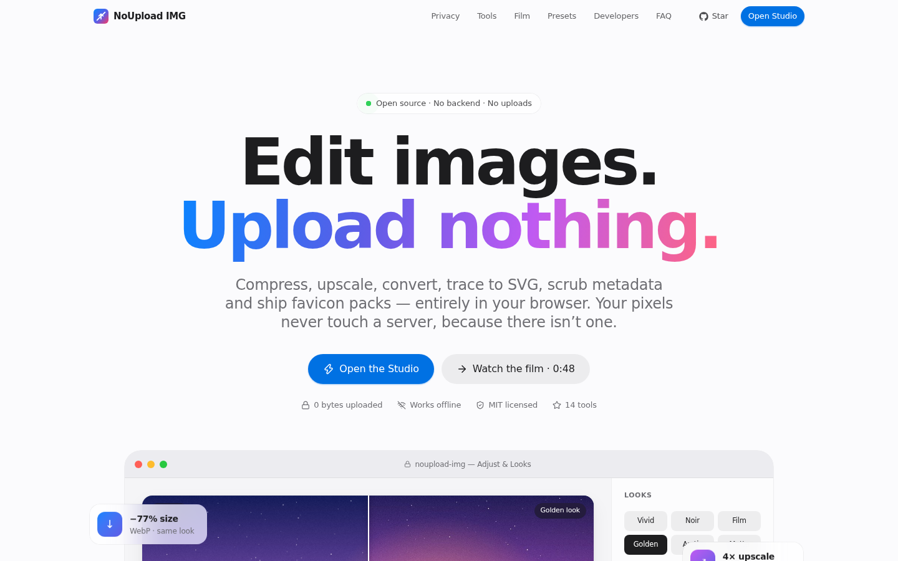
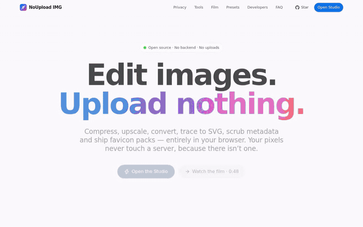
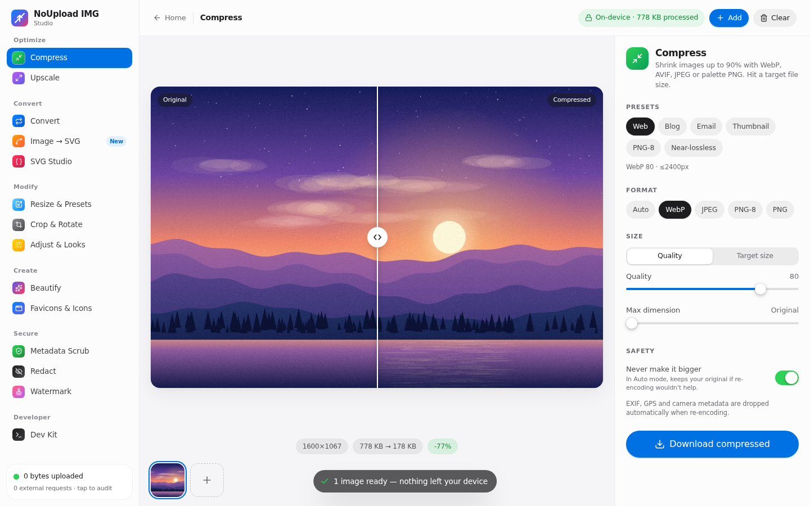
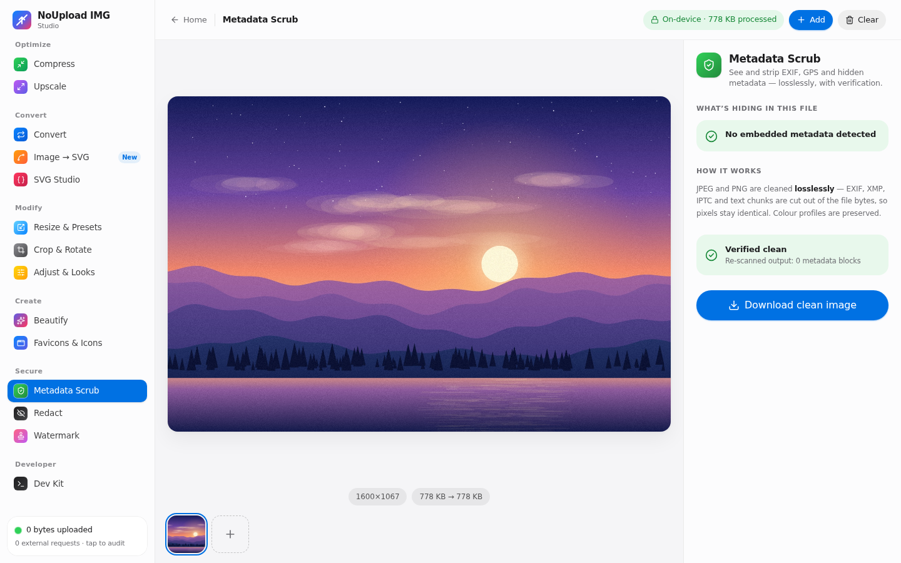

# NoUpload IMG

### Edit images. Upload nothing.

A privacy-first image toolkit that runs entirely in the browser — compress, upscale,
convert, trace to SVG, strip metadata and ship icon packs, with **no backend, no
accounts and zero bytes uploaded**.

 

 

**Portfolio showcase** · Source is held privately and is available on request.

---

## The 48-second launch film

<video src="docs/launch-film.mp4" poster="docs/hero.png" controls playsinline preload="metadata" width="100%">
  Your browser does not support embedded video. <a href="docs/launch-film.mp4">Watch the launch film</a>.
</video>

Full quality: [launch-film.mp4](docs/launch-film.mp4) · Looping preview: [launch-film.gif](docs/launch-film.gif)

| | | | |
| --- | --- | --- | --- |
| **0:00** Intro | **0:06** The problem | **0:13** Drop & edit | **0:20** Compress |
| **0:25** Upscale & convert | **0:28** For developers | **0:35** Privacy | **0:41** Presets |

The film is rendered frame-by-frame from the same interface code as the app — it is a real walkthrough, not a screen recording.

---

## The idea

Most online image editors ask you to upload your files to a server and then promise,
in a privacy policy, not to look at them. NoUpload IMG removes that step entirely.

The whole product is **one self-contained HTML file**. Images are decoded into browser
memory, processed with built-in browser APIs, and downloaded straight back to disk.
There is no server to trust, and no account to create.

The landing page — privacy proof, live playground, launch film, presets and theme picker.

---

## What it does

**Fourteen tools, grouped the way you actually work:**

| Group | Tools |
| --- | --- |
| **Optimize** | Compress (WebP / AVIF / JPEG / PNG-8, or hit an exact target file size), Upscale (1.5×–4× with adaptive sharpening) |
| **Convert** | Bulk convert to PNG / JPEG / WebP / AVIF / PDF / ICO, rasterise SVG, trace images to SVG from scratch |
| **Modify** | Resize with 40+ platform presets, crop & rotate, nine sliders and nine one-tap looks |
| **Create** | Screenshot beautifier, full favicon and PWA icon packs |
| **Secure** | Lossless EXIF/GPS metadata scrub, irreversible redaction, watermarking |
| **Developer** | Base64 and data URIs, LQIP placeholders, palette → CSS variables, responsive `srcset` ZIP, hashes |

Everything supports live preview, batch processing and ZIP export.

### A few details worth calling out

- **Target-file-size compression** — ask for "≤ 150 KB" and the app finds the quality that fits, refusing to make files bigger.
- **Metadata scrubbing is byte-level** for JPEG and PNG, so pixels are never re-encoded.
- **Image → SVG** uses hand-written colour quantisation, contour tracing and Bézier smoothing.
- **40+ export presets** cover GitHub cards, OG images, app-store art, social posts and PWA icons in one ZIP.
- **Six themes** — Original, Mono, Paper, Linen, Slate and Graphite — switch instantly and are remembered on the device.

---

## Product tour

### Animated walkthroughs

| Landing page | Compression workflow |
| --- | --- |
|  |  |
| All eleven sections of the landing experience. | Before / after comparison and target-size mode. |

| Studio tools | Launch film (loop) |
| --- | --- |
|  |  |
| Optimize → Convert → Modify → Create → Secure → Developer. | The full 48-second film as a lightweight loop. |

### Screenshots

| Compress | Metadata scrub |
| --- | --- |
|  |  |

| SVG export | Landing hero |
| --- | --- |
|  |  |

All media is catalogued in [MEDIA.md](MEDIA.md).

---

## Privacy by architecture, not by promise

- **No backend exists.** The production build is a single file that can be double-clicked or hosted anywhere.
- **No third parties.** No analytics, no CDNs, no external fonts, no tracking pixels.
- **Live network audit.** The Studio instruments outbound requests and displays them while you work — the counter stays at zero.
- **Works offline.** Turn on airplane mode and everything still functions.

See [PRIVACY.md](PRIVACY.md) for the full explanation.

---

## Built with

React 19 · TypeScript 5.9 · Vite 7 · Tailwind CSS 4 · Canvas, Web Crypto and Compression Streams

The film, screenshots and tours in this repository are the real interface — generated
deterministically from the product rather than mocked up for documentation.

---

## Source code

The implementation is kept in a private repository to protect the original work.
It is available to recruiters and hiring teams on request. This repository exists
to document the product, its design decisions and the result.

See [SHOWCASE_NOTICE.md](SHOWCASE_NOTICE.md) before publishing or sharing.

---

Built by **Avartan Thlay** · [GitHub](https://github.com/avartan007)

[Project summary](PROJECT_SUMMARY.md) · [Features](FEATURES.md) · [Privacy](PRIVACY.md) · [Media](MEDIA.md) · [Setup notes](REPO_SETUP.md)

